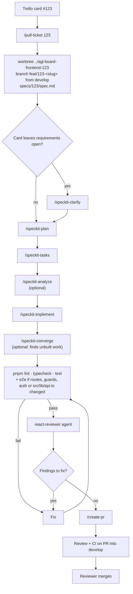

# AGI Board — frontend

React + TypeScript SPA for AGI Board, deployed as static assets on Cloudflare Workers.

## Requirements

- Node 22 (`.nvmrc`)
- pnpm via Corepack: `corepack enable pnpm`

## Getting started

```sh
pnpm install
cp .env.example .env.local   # point to your local API and WebSocket
pnpm dev
```

## Scripts

| Script                              | What it does                                                         |
| ----------------------------------- | -------------------------------------------------------------------- |
| `pnpm dev`                          | Dev server with HMR                                                  |
| `pnpm build`                        | Type-check and build to `dist/`                                      |
| `pnpm preview`                      | Serve the built app                                                  |
| `pnpm lint`                         | oxlint                                                               |
| `pnpm typecheck`                    | `tsc -b`                                                             |
| `pnpm test` / `pnpm test:watch`     | Vitest unit tests (MSW mocks the API)                                |
| `pnpm e2e`                          | Playwright (first run: `pnpm exec playwright install chromium`)      |
| `pnpm format` / `pnpm format:check` | Prettier                                                             |
| `pnpm deploy:staging`               | `wrangler deploy --env staging` (CI does this on merge to `develop`) |

## Stack

Vite · React 19 · React Router · TanStack Query · Tailwind CSS v4 · shadcn/ui (Radix) · react-hook-form + zod · lucide-react · Vitest + Testing Library + MSW · Playwright · Wrangler.

## Structure

```
src/
  app/          router, providers, layouts, guards
  features/     one folder per feature (auth, workspaces, boards, cards, ...)
  components/   ui/ (shadcn, generated) and common/ (shared)
  lib/          api client (cookie + CSRF), WebSocket hook, query client, env
  styles/       tokens.css (from the design) and Tailwind entry
  test/         Vitest setup and MSW server
e2e/            Playwright tests
```

Route ↔ screen table and decisions: `docs/frontend-init-plan.md` in the parent `agi-board` repo.

## Working on a task

Every task is a Trello card on the "AGI Board" board. Run these steps in Claude Code:



Notes:

- `/pull-ticket` creates a git worktree `../agi-board-frontend-<card number>/` on the branch
  `<type>/<card number>-<slug>` from `develop` (not pushed), copies `.env.local` and runs `pnpm install` there,
  writes `specs/<card number>/spec.md` (the card, verbatim, no analysis), points speckit at that folder and
  suggests `/speckit-clarify` or `/speckit-plan`. `/speckit-specify` is not needed. Commit
  `specs/<card number>/` with the code so reviewers see the spec, plan and tasks.
- One worktree per ticket lets you work on several tickets in parallel: open each in its own editor window or
  Claude session (`cd ../agi-board-frontend-123 && claude`). The main checkout is never switched. Several
  `pnpm dev` servers can run at once (Vite picks the next free port). After the PR is merged, run
  `git worktree remove ../agi-board-frontend-123`.
- Planning and implementing read the screen spec, labels and mockups from the parent repo (`../specs/`,
  `../docs/ui-pipeline/`); `spec.md` only holds the card.
- `/speckit-clarify` writes its answers into `spec.md`. When the card itself changes, re-run `/pull-ticket`:
  it asks before overwriting `spec.md` (clarify answers in it are lost; `plan.md` and `tasks.md` are kept).
- Reviews: ask Claude Code to run the `react-reviewer` agent. Fix the findings, then run the checks again.
- `/create-pr` checks the branch name and commit format, runs `lint`, `typecheck` and `test` again, and opens
  the PR into `develop`. It never merges.

## Git conventions

- Branches: `<type>/<kebab-slug>` from `develop`, e.g. `feat/init-structure`, `fix/board-404` (`scripts/check-branch-name.sh`, run on `pre-push`). `/pull-ticket` creates it for you (see [Working on a task](#working-on-a-task)).
- Commits: `<type>(<scope>): #<trello-card> <Imperative summary>`, e.g. `feat(boards): #123 Add route guards` (`commitlint.config.mjs`, run on `commit-msg`).
- Hooks are installed by husky on `pnpm install`. CI checks both on every PR.

## CI/CD

`.github/workflows/ci.yml` runs lint, format check, typecheck, unit and E2E tests on every PR and push. After the checks pass on a push it calls `.github/workflows/deploy.yml`: `develop` → staging (https://agi-board-staging.huyen-cao.workers.dev), `main` → production (https://agi-board-app.huyen-cao.workers.dev), then a smoke test against the deployed URL.

GitHub → Settings → Environments `staging` and `production` (add required reviewers on `production`), each with:

- Secrets `CLOUDFLARE_API_TOKEN` (Workers Scripts: Edit), `CLOUDFLARE_ACCOUNT_ID`
- Variables `VITE_API_BASE_URL` (backend Worker URL + `/api/v1`, e.g. `https://agi-board-backend-staging.huyen-cao.workers.dev/api/v1`), `VITE_WS_BASE_URL`, `FRONTEND_URL` (the URL above, for the smoke test)
